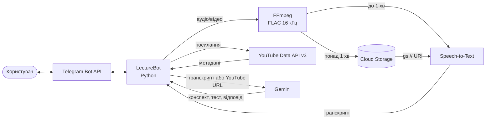
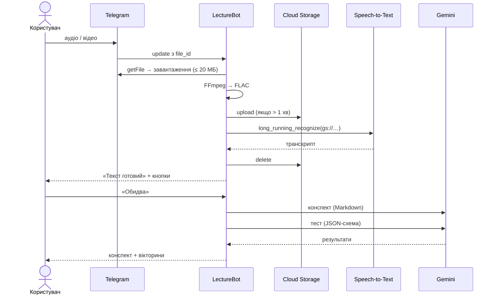

# LectureBot

Telegram-бот, який перетворює запис лекції на **структурований конспект** і **тест для
самоперевірки** та відповідає на запитання за матеріалом. PoC-проєкт для курсу «Хмарні
обчислення» на основі сервісів Google Cloud.

> 🎥 Демо-відео: _посилання буде додано_

## Проблема і рішення

Відеолекції тривають десятки хвилин, а на перегляд, нотатки й підготовку до перевірки
знань іде багато часу. LectureBot приймає аудіо, відео або посилання на YouTube, отримує
текст лекції й за кілька хвилин повертає конспект і тест, який можна пройти прямо в Telegram.

**Сфери застосування:** студенти й учні (підготовка до занять і екзаменів), викладачі
(швидке складання запитань за лекцією), самонавчання за відеокурсами, автори онлайн-курсів
(конспекти й тести до власних відео).

## Можливості

- 🎤 голосові повідомлення, 🎧 аудіофайли, 🎬 відео й кружечки (до 20 МБ);
- 🔗 публічні YouTube-відео за посиланням (до 60 хв);
- ⚡ короткий переказ: 3–5 речень і ключові слова;
- 📝 конспект: тема, основні ідеї, ключові терміни, висновки (повідомленням і файлом `summary.md`);
- ❓ тест у вигляді нативних Telegram-вікторин з поясненням правильної відповіді;
- 💬 відповіді на запитання за лекцією;
- 📄 повний транскрипт файлом.

## Використані API

| Сервіс | Роль у проєкті |
|---|---|
| **Telegram Bot API** | Інтерфейс користувача: команди, файли, кнопки, вікторини (`sendPoll`, тип `quiz`) |
| **Google Cloud Speech-to-Text** | Розпізнавання мовлення: `recognize` для записів до 1 хв, `long_running_recognize` для довших |
| **Google Cloud Storage** | Тимчасове зберігання аудіо для асинхронного розпізнавання (видаляється одразу після обробки) |
| **Gemini на Google Cloud** (Agent Platform, раніше Vertex AI) | Конспект, тест (JSON за схемою), відповіді на запитання, аналіз YouTube-відео за посиланням |
| **YouTube Data API v3** | Метадані відео (`videos.list`): назва, канал, тривалість, статус доступу |

Допоміжно: **FFmpeg** витягує аудіодоріжку й конвертує її у FLAC 16 кГц моно.

## Архітектура



### Послідовність обробки файлу



Для YouTube бот спершу перевіряє відео через YouTube Data API (публічне, не трансляція,
не довше за ліміт), а потім передає посилання безпосередньо в Gemini. Бот нічого не
завантажує з YouTube.

## Структура проєкту

```text
bot/
├── main.py             # точка входу: polling локально, webhook на Cloud Run
├── config.py           # налаштування зі змінних середовища
├── handlers.py         # команди, файли, YouTube, кнопки, запитання
├── media_utils.py      # FFmpeg: конвертація та тривалість
├── storage.py          # Cloud Storage
├── speech_to_text.py   # Speech-to-Text
├── gemini_service.py   # Gemini: конспект, тест, відповіді, YouTube
├── youtube_service.py  # YouTube Data API v3
├── prompts.py          # промпти
├── schemas.py          # схема тестового запитання та валідація
├── text_utils.py       # ліміти Telegram, Markdown → HTML
└── errors.py
tests/                  # pytest
Dockerfile              # образ для Cloud Run
.env.example            # шаблон налаштувань (без секретів)
```

## Запуск локально

Потрібно: Python 3.11+, FFmpeg, gcloud CLI, проєкт Google Cloud з увімкненими
Speech-to-Text, Vertex AI та YouTube Data API v3, бакет Cloud Storage і токен бота від
@BotFather. Покрокове налаштування — у [SETUP.md](SETUP.md).

```powershell
python -m venv .venv
.venv\Scripts\Activate.ps1
pip install -r requirements.txt
copy .env.example .env          # заповнити значення

gcloud auth application-default login
gcloud auth application-default set-quota-project <PROJECT_ID>

python -m bot.check_setup       # перевіряє ключі, доступи та всі API
python -m bot.main
```

Або в Docker (той самий образ, що й для Cloud Run):

```powershell
docker build -t lecturebot .
docker run --rm --env-file .env -v "$env:APPDATA\gcloud:/root/.config/gcloud:ro" lecturebot
```

Секрети зберігаються лише в `.env` (є в `.gitignore`) або в Secret Manager. Доступ до
Google Cloud — через Application Default Credentials, без JSON-ключів у репозиторії.

## Тести

```powershell
pytest
```

Покривають розбір YouTube-посилань і тривалості, валідацію тесту під ліміти Telegram,
розбиття довгих повідомлень, конвертацію Markdown і FFmpeg (якщо встановлено).

## Розгортання на Cloud Run (опційно)

У хмарі бот працює в режимі webhook. Параметри `--no-cpu-throttling` і `--min-instances 1`
потрібні, щоб обробка тривала у фоні після відповіді Telegram.

```powershell
gcloud services enable run.googleapis.com cloudbuild.googleapis.com artifactregistry.googleapis.com secretmanager.googleapis.com

gcloud iam service-accounts create lecturebot-sa
$SA = "lecturebot-sa@<PROJECT_ID>.iam.gserviceaccount.com"
foreach ($role in "roles/speech.client", "roles/aiplatform.user", "roles/storage.objectAdmin", "roles/secretmanager.secretAccessor") {
  gcloud projects add-iam-policy-binding <PROJECT_ID> --member "serviceAccount:$SA" --role $role
}

# Секрети telegram-bot-token і youtube-api-key створити в Console: Security → Secret Manager

gcloud run deploy lecturebot --source . --region us-central1 `
  --service-account $SA --allow-unauthenticated `
  --no-cpu-throttling --min-instances 1 --max-instances 1 --memory 1Gi --timeout 3600 `
  --set-env-vars "GOOGLE_CLOUD_PROJECT=<PROJECT_ID>,GCS_BUCKET=<BUCKET>,GEMINI_MODEL=<MODEL>,GOOGLE_CLOUD_LOCATION=global" `
  --set-secrets "TELEGRAM_BOT_TOKEN=telegram-bot-token:latest,YOUTUBE_API_KEY=youtube-api-key:latest"

# Після першого деплою: вказати URL сервісу, щоб бот зареєстрував webhook
gcloud run services update lecturebot --region us-central1 `
  --update-env-vars "WEBHOOK_URL=<SERVICE_URL>,WEBHOOK_SECRET=<random-string>"
```

Щоб повернутися до локального запуску, зупиніть сервіс (`gcloud run services delete lecturebot
--region us-central1`) і запустіть `python -m bot.main`: polling сам вимкне webhook.

## Вартість (Free Trial)

Новий акаунт Google Cloud отримує $300 кредитів на 90 днів. Speech-to-Text — 60 хв/міс
безкоштовно, Cloud Storage — 5 ГБ у регіонах US, YouTube Data API — 10 000 одиниць квоти
на день (`videos.list` = 1). Gemini оплачується за токени (для PoC — центи). Cloud Run з
постійно ввімкненим інстансом (1 vCPU, 1 ГБ) — близько $10 на тиждень, тому його варто
вмикати лише на час демонстрації.

## Обмеження

- файли до 20 МБ (ліміт хмарного Telegram Bot API) — для довгих лекцій надсилайте аудіо;
- лише публічні YouTube-відео до 60 хв (налаштовується);
- якість транскрипту залежить від якості звуку;
- конспект і тест генеруються автоматично й можуть містити помилки;
- транскрипт зберігається в пам'яті процесу й зникає після перезапуску бота.

## Документація API

- Telegram Bot API — https://core.telegram.org/bots/api
- Speech-to-Text — https://cloud.google.com/speech-to-text/docs
- Cloud Storage — https://cloud.google.com/storage/docs
- Gemini на Google Cloud — https://cloud.google.com/vertex-ai/generative-ai/docs
- YouTube Data API v3 — https://developers.google.com/youtube/v3
